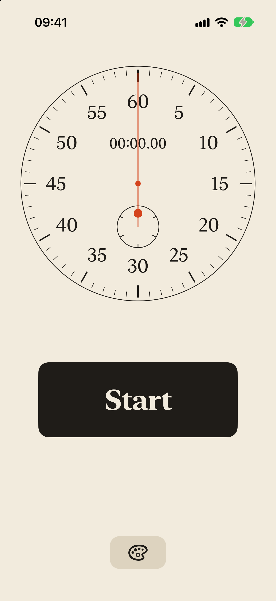
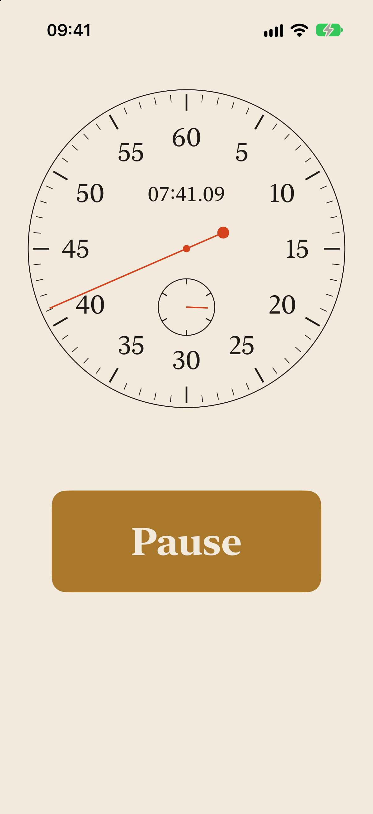
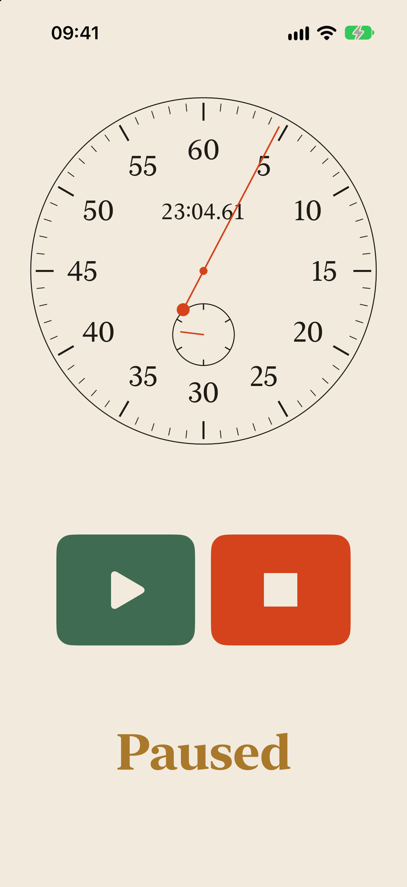
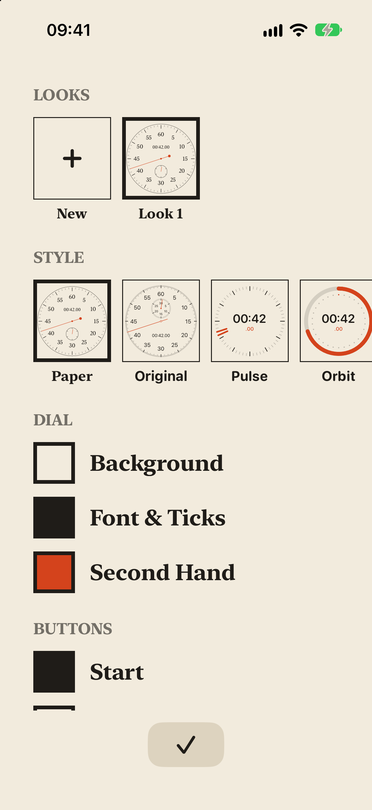
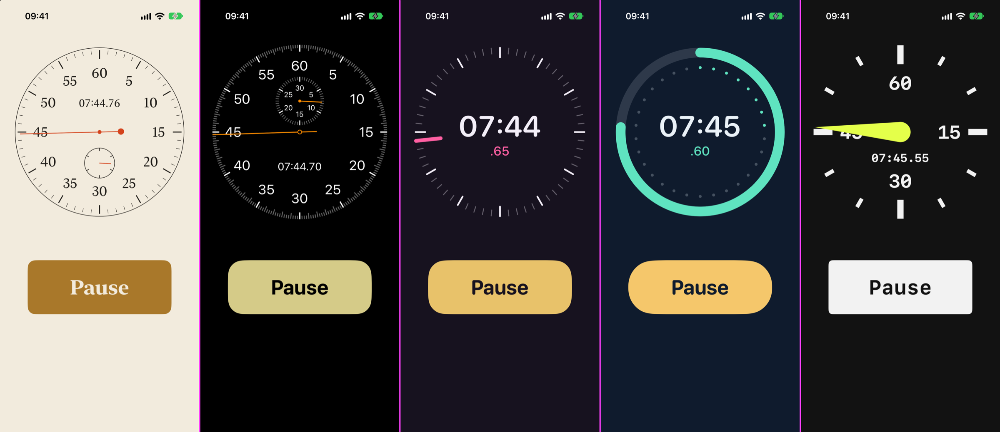
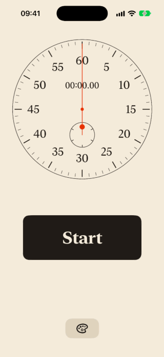

# stahpwatch

A single-purpose stopwatch for iPhone: one big button, five dial styles drawn in code (Paper, Original, Pulse, Orbit and Block), fully custom colors saved as Looks, and a Lock Screen / Dynamic Island Live Activity. Swift + SwiftUI, iOS 17+, iPhone only, portrait only, no third-party packages. See [SPEC.md](SPEC.md) for the full design and [ROADMAP.md](ROADMAP.md) for what's next.

<p align="center">
  
  
  
  
</p>
<p align="center"><sub>Idle · Running · Paused · Customize, in Paper, the default style</sub></p>

<p align="center">
  
</p>
<p align="center"><sub>Paper · Original · Pulse · Orbit · Block</sub></p>

<p align="center">
  
</p>

## Build

The Xcode project is generated from `project.yml` with [XcodeGen](https://github.com/yonaskolb/XcodeGen) and isn't committed.

```bash
brew install xcodegen        # or download the release zip and put bin/xcodegen on your PATH
xcodegen generate
open stahpwatch.xcodeproj
```

### Signing (free personal team)

Personal signing details stay out of git. Copy the example config and fill in your values:

```bash
cp Config/Local.xcconfig.example Config/Local.xcconfig
```

- `DEVELOPMENT_TEAM`: your personal Team ID. If you don't know it, add your Apple ID in Xcode → Settings → Accounts, open the project, pick your Personal Team under the stahpwatch target's Signing & Capabilities, and read the ID back (it appears in the build settings as `DEVELOPMENT_TEAM`). Then put it in `Local.xcconfig` and run `xcodegen generate` again, so it survives regeneration.
- `BUNDLE_ID_PREFIX`: free teams need a globally unique bundle ID. The default is `com.jacobtehrani`.

The project uses no capabilities that need a paid account: no App Groups, push notifications or iCloud.

## Run on a physical iPhone

1. Connect the iPhone by cable (or on the same Wi-Fi once paired) and pick it as the run destination in Xcode.
2. **Turn on Developer Mode** on the iPhone: Settings → Privacy & Security → Developer Mode, then restart when asked.
3. Press Run in Xcode. The first install fails to open with an "Untrusted Developer" message.
4. **Trust your developer profile:** Settings → General → VPN & Device Management → your Apple ID → Trust.
5. Launch stahpwatch again.

**Free accounts expire after 7 days.** Apps signed with a free Apple account stop launching after 7 days. Reinstall from Xcode (just press Run again) to renew. Your settings and any running stopwatch are kept.

## Releases

`main` is the stable version. Each version installed on the owner's iPhone is tagged on `main` (`v1.1`, `v1.2`, and so on). New features are built on a branch named for the feature, such as `tap-to-start`, and merged into `main` only when they're ready.

To install a specific version on a connected iPhone, for example to go back to an earlier release:

```bash
./Scripts/install.sh v1.1
```

It accepts any tag or branch. It builds in a temporary git worktree, so your working folder isn't touched, regenerates the Xcode project with XcodeGen, signs with `Config/Local.xcconfig`, and installs over the existing app so its data stays. Add `--simulator` to install on the booted Simulator instead, or `--device <UDID>` to pick a specific iPhone. Installing an older version keeps your data, but an older version may not understand settings saved by a newer one; see the notes in `Scripts/install.sh`.

## Test

```bash
xcodebuild -project stahpwatch.xcodeproj -scheme stahpwatch \
  -destination 'platform=iOS Simulator,name=iPhone 17' test
```

The tests cover elapsed-time math, every transition, saving and restoring state (including a simulated force-quit), readout formatting (including the one-hour switch), settings and Match Background, and the screen-awake hold rules.

`DialSnapshot` is skipped by default. Set `TEST_RUNNER_DIAL_SNAPSHOT_DIR=/some/dir` to render the dial at 2× for comparison with the Figma dial reference (frame `2:4` in the StopWatch file). That reference isn't published here; export it locally to `Design/dial-reference.png`, which git ignores. It also renders the Paused screen at iPhone SE (375 × 647) and Pro Max (440 × 868) safe-area sizes.

## Screenshots and demo

The images in `docs/` come from the iPhone 17 Simulator with the status bar set to 9:41 (`xcrun simctl status_bar booted override --time 9:41`). The demo GIF is a Simulator screen recording (`xcrun simctl io booted recordVideo demo.mov`) converted with:

```bash
swift Scripts/make_gif.swift demo.mov docs/demo.gif 320 15 1.0 24.5
```

The arguments are width, frames per second, and the start and end of the clip in seconds.

`docs/styles.png` puts five Running screenshots side by side, one per style, each with that style's default colors.

## App icon

`Scripts/make_icon.swift` draws the 1024 × 1024 icon with Core Graphics. It uses no SF Symbols, since Apple's license doesn't allow them in app icons. To change the icon, edit the script and run:

```bash
swift Scripts/make_icon.swift
```

## Roadmap

Planned work is in [ROADMAP.md](ROADMAP.md).

## License

stahpwatch is released under the [MIT License](LICENSE). Copyright (c) 2026 Jacob Tehrani.

## Structure

| Path | What |
| --- | --- |
| `stahpwatch/Model/StopwatchState.swift` | Timestamp-only timing, transitions, UserDefaults store |
| `stahpwatch/Model/StopwatchModel.swift` | Observable source of truth shared by the UI and Live Activity intents |
| `stahpwatch/Model/AppSettings.swift` | Looks, the 14 settings, Match Background, migration |
| `stahpwatch/Model/DialStyle.swift` | The five dial styles: font, button shape and default colors |
| `stahpwatch/Model/Look.swift` | A named dial style and colors; one is always active |
| `stahpwatch/Model/ScreenAwakeController.swift` | Dim Timer hold and touch-reset countdown |
| `stahpwatch/Model/LiveActivityController.swift` | Starts, updates and ends the Live Activity |
| `stahpwatch/Views/` | `MainView`, `DialView` and `DialRenderer` (a static face Canvas under a live TimelineView Canvas), `ControlsView`, `CustomizeView`, pickers |
| `Shared/` | Live Activity attributes and the Pause / Resume / Reset intents (compiled into both targets) |
| `LiveActivity/` | Widget extension: Lock Screen and Dynamic Island UI |

## Choices where the spec was silent

- **Color picker:** the swatch opens `UIColorPickerViewController` in a sheet. This is the same built-in picker SwiftUI's `ColorPicker` presents. It's used directly so the square 45 × 45 swatch can be the trigger, since `ColorPicker` always draws its own round well. Changes apply live while dragging.
- **Touch after the Dim Timer ran out:** a touch while Running or Paused starts a new hold, even if the previous countdown already handed control back to Auto-Lock.
- **Inactive scene** (Control Center, notification shade, app switcher) releases the hold. Returning starts a fresh one, as on unlock.
- **Status bar:** light text when white has more contrast on Background than black does (relative luminance below 0.179).
- **Readout hundredths** are truncated, not rounded.
- **Layout:** buttons scale with screen width. The dial scales with width too, but shrinks further on short screens (iPhone SE) so everything fits. Space for the "Paused" label and the Customize button is always reserved, so the buttons never move between states.
- **Live Activity running time** counts up with `Text(timerInterval:)` over a one-year range.
- **Looks:** one Look is always active, and changing a color or style edits it, with no Save step. Changing style keeps the Look's colors; the Use Default Colors button applies the style's defaults. The New tile and Duplicate make a copy to experiment on. Colors customized before Looks existed became Looks, such as My Original.
- **Dim Timer** isn't part of a Look, and it has its own reset in its picker.
- **Debug only:** launching with `-showCustomize` opens straight to Customize, for Simulator screenshots.
